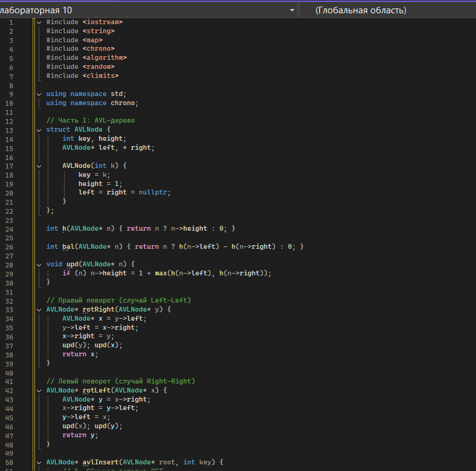
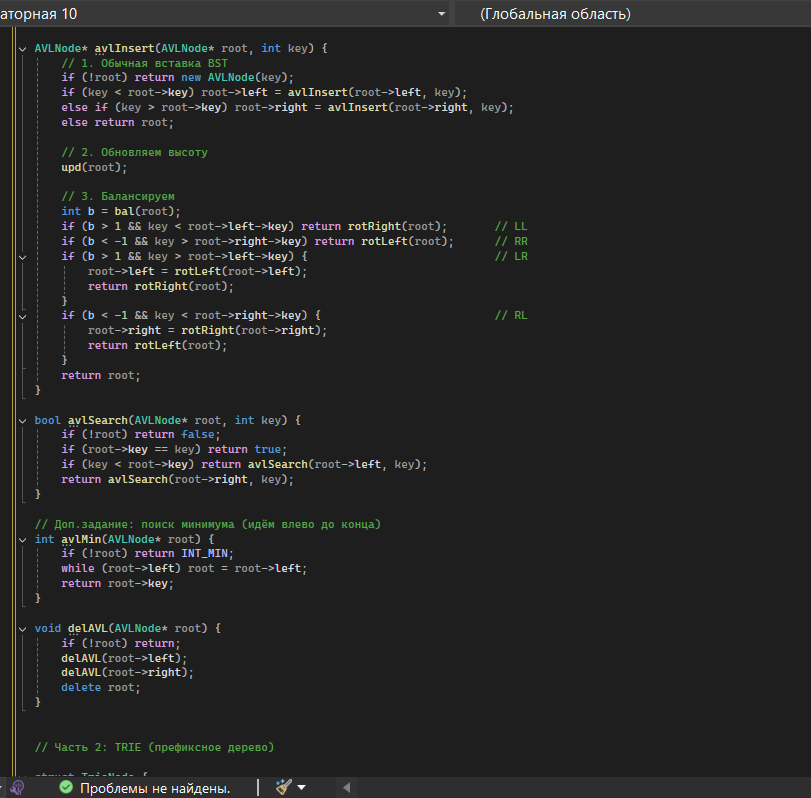
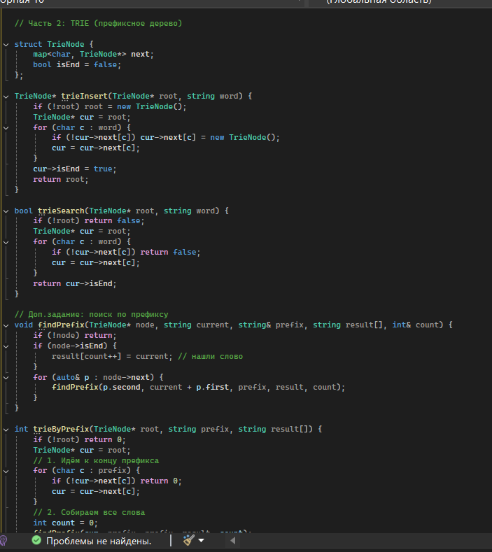
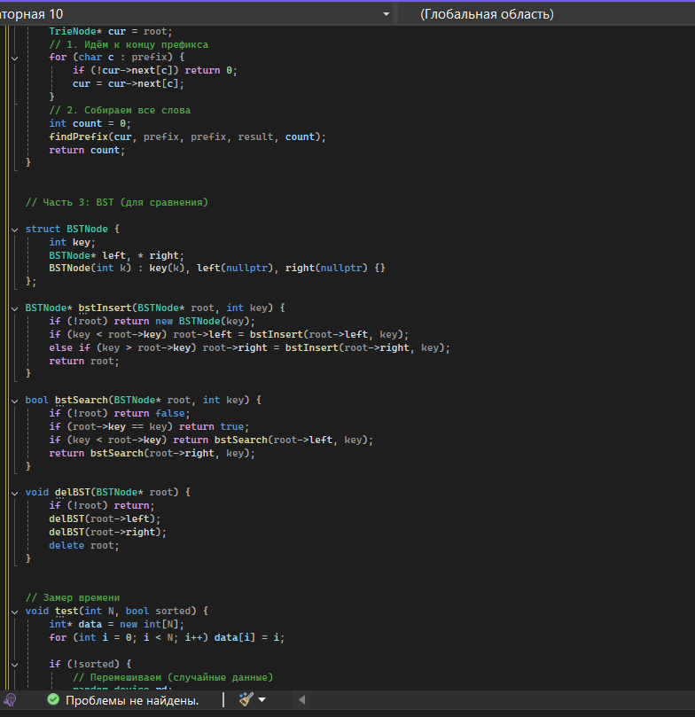
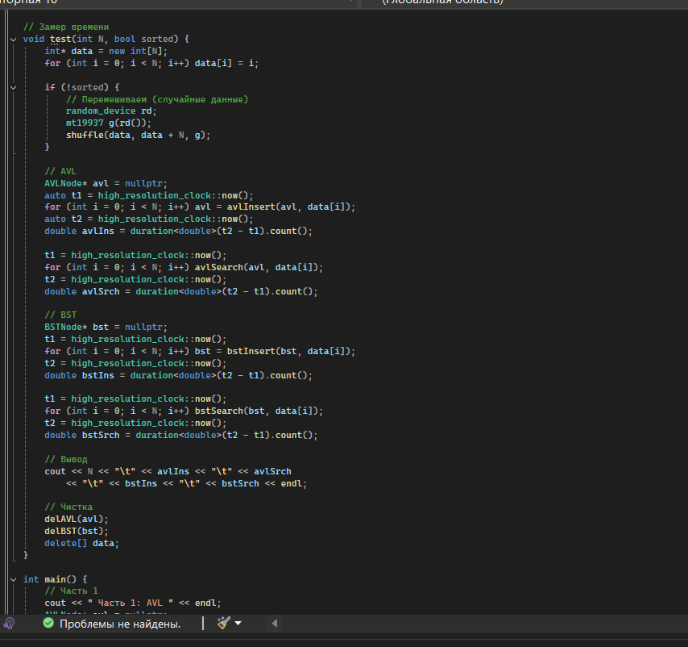
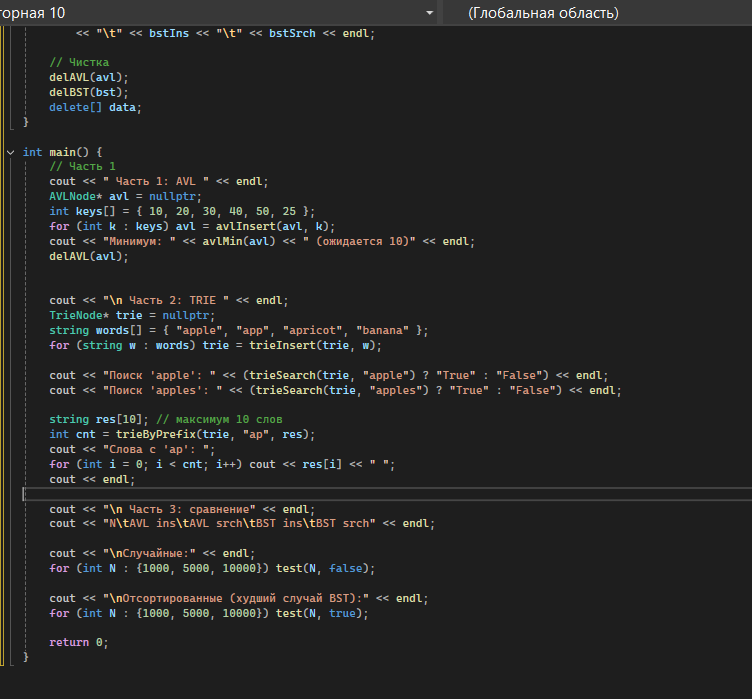
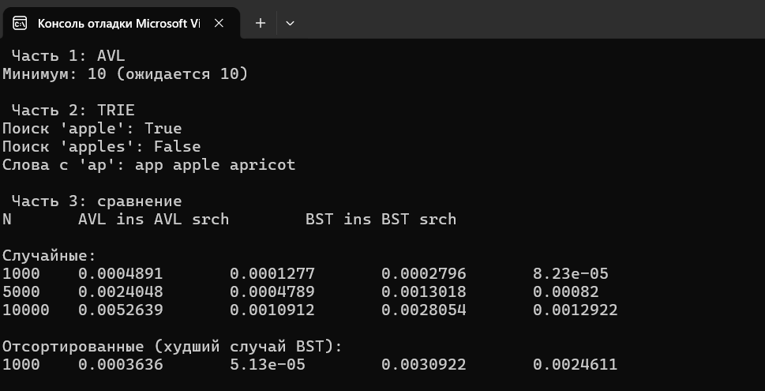

# Лабораторная работа №10
## AVL-дерево. Префиксное дерево (Trie)

**Выполнила:** *Агафонова Софья Сергеевна*  
**Группа:** *ПИЖ-б-о-25-1*  
**Вариант:** 1 
---

## Цель работы

1. Реализовать самобалансирующееся AVL-дерево с операциями
вставки, удаления и поиска
2. Освоить механизмы балансировки: малые и большие повороты
(правый, левый, правый-левый, левый-правый)
3. Изучить структуру данных «префиксное дерево» (Trie) для
эффективного хранения и поиска строк
4. Реализовать операции вставки, поиска и удаления в Trie
5. Сравнить производительность AVL-дерева, BST и Trie для
различных типов данных
---
# Теоретическая часть

## 1. AVL-дерево

**AVL-дерево** — самобалансирующееся двоичное дерево поиска. Для каждого узла выполняется:

\[
|h_L - h_R| \le 1
\]

Разность высот называется **фактором баланса** (допустимо \(-1, 0, +1\)). Благодаря балансировке высота дерева \(O(\log n)\), значит поиск, вставка и удаление — **\(O(\log n)\)**.

## 2. Повороты

При нарушении баланса (фактор \(\pm 2\)) выполняются локальные повороты за \(O(1)\), сохраняющие свойство BST.

| Случай | Условие | Действие |
|--------|---------|----------|
| **LL** | перевес влево, левый ребёнок влево | правый поворот |
| **RR** | перевес вправо, правый ребёнок вправо | левый поворот |
| **LR** | перевес влево, левый ребёнок вправо | левый + правый |
| **RL** | перевес вправо, правый ребёнок влево | правый + левый |

Пример правого поворота:

```
    A            B
   / \          / \
  B   C   →    D   A
 / \              / \
D   E            E   C
```

После вставки хватает одного поворота, после удаления — до \(O(\log n)\).

## 3. Trie (префиксное дерево)

**Trie** — дерево для хранения строк, где путь от корня задаёт строку. Узел содержит переходы по символам и флаг конца слова.

```
       (root)
      /  |  \
     c   d   t
     |   |   |
     a   o   o
     |   |   |
     t   d   p
   (cat)(dog)(top)
```

| Операция | Сложность |
|----------|-----------|
| insert / search / startsWith | \(O(L)\), где \(L\) — длина строки |

**Плюсы:** быстрый поиск по префиксу, автодополнение, лексикографический обход.
**Минусы:** большой расход памяти.
**Применение:** автодополнение, словари, IP-маршрутизация, T9.

---
## Постановка задачи

**Общее задание**
1. **Бинарное дерево:** Реализовать рекурсивные обходы (`preOrder`, `inOrder`, `postOrder`) и функцию подсчета количества узлов.
2. **BST:** Реализовать вставку, поиск и симметричный обход. Дополнительно: реализовать удаление узла (с обработкой трех случаев: лист, один потомок, два потомка).
3. **Применение:** Создать BST из 20 случайных чисел, вывести отсортированный массив (in-order), найти минимум, максимум, высоту дерева и удалить заданный пользователем узел.

### Часть 1. AVL-дерево

| Обязательные операции | Дополнительное задание |
|:---|:---|
| Вставка, балансировка | Найти минимальный элемент |

**Задание:**
1. Реализовать структуру узла AVL-дерева (ключ, указатели на потомков, высота).
2. Реализовать операцию **вставки** нового элемента с сохранением свойств бинарного дерева поиска.
3. Реализовать механизм **балансировки**:
   - вычисление фактора баланса (`balanceFactor`);
   - обновление высоты узла (`updateHeight`);
   - малые повороты (левый и правый);
   - большие повороты (левый-правый и правый-левый).
4. Реализовать функцию **поиска минимального элемента** (крайний левый узел).
5. Продемонстрировать работу: вставить элементы, вызывающие разные виды дисбаланса, вывести структуру дерева и найденный минимальный элемент.

---

### Часть 2. Префиксное дерево (Trie)

| Обязательные операции | Дополнительное задание |
|:---|:---|
| Вставка, поиск | Поиск по префиксу |

**Задание:**
1. Реализовать структуру узла Trie (массив/словарь потомков для букв латинского алфавита, флаг `isEndOfWord`).
2. Реализовать обязательные операции:
   - **Вставка** (`insert`) — добавление слова;
   - **Поиск** (`search`) — проверка наличия точного совпадения слова.
3. Реализовать дополнительное задание — **Поиск по префиксу** (`startsWith`): возвращает `true`, если в дереве есть хотя бы одно слово с заданным префиксом, иначе `false`.
4. Реализовать деструктор для очистки памяти.
5. Продемонстрировать работу на наборе слов (`"cat"`, `"car"`, `"dog"`, `"cart"`, `"catfish"`), проверив поиск слов и поиск по префиксу.

---

### Часть 3. Сравнительный анализ

**Задание:**
1. **Реализация:** реализовать AVL-дерево и обычное BST.
2. **Сравнение производительности:** сравнить время выполнения операций **вставки** и **поиска** для \(N = 1000, 5000, 10000\) элементов. Замеры провести для двух сценариев:
   - **Случайные данные**;
   - **Отсортированные данные** (худший случай для BST).
3. **Оформление результатов:** построить таблицу и/или график зависимости времени выполнения от \(N\). Сравнить показатели BST и AVL-дерева, сделать выводы об эффективности балансировки.

---

## Индивидуальное задание



*Рисунок 1- Код программы*



*Рисунок 2- Код программы*



*Рисунок 3- Код программы*



*Рисунок 4- Код программы*



*Рисунок 5- Код программы*



*Рисунок 6- Код программы*

## Результаты работы программы


*Рисунок 7- Результат программы*

---
## Ответы на контрольные вопросы

**1. AVL-дерево**
AVL-дерево — это сбалансированное двоичное дерево поиска, в котором для каждого узла высоты левого и правого поддеревьев отличаются не более чем на единицу. Оно было названо в честь советских математиков Г. М. Адельсона-Вельского и Е. М. Ландиса и является одной из первых структур данных, обеспечивающих гарантированное время поиска \(O(\log n)\) за счёт автоматической балансировки при вставке и удалении.

**2. Что такое AVL-дерево? В чём его отличие от обычного BST?**
AVL-дерево — это самобалансирующееся бинарное дерево поиска. Его главное отличие от обычного BST заключается в том, что AVL-дерево автоматически поддерживает минимально возможную высоту. В обычном BST при вставке отсортированных данных дерево может выродиться в связный список (сложность операций упадёт до \(O(n)\)), тогда как AVL-дерево благодаря механизму поворотов всегда гарантирует логарифмическую высоту и сложность \(O(\log n)\).

**3. Что такое фактор баланса? Как он вычисляется?**
Фактор баланса — это числовой показатель степени перевеса одного поддерева над другим. Он вычисляется как разность высот левого и правого поддеревьев конкретного узла: `Высота(Левое) - Высота(Правое)`. В AVL-дереве допустимыми значениями фактора баланса являются только -1, 0 и 1.

**4. Какие существуют типы поворотов в AVL-дереве?**
Существует четыре типа поворотов, используемых для восстановления баланса: малый правый поворот (Right Rotation), малый левый поворот (Left Rotation), большой левый-правый поворот (Left-Right Rotation) и большой правый-левый поворот (Right-Left Rotation).

**5. Когда применяется правый поворот? Левый поворот?**
Правый поворот применяется, когда фактор баланса узла равен `+2` (левый перевес), а фактор баланса его левого потомка больше или равен нулю. Левый поворот применяется, когда фактор баланса узла равен `-2` (правый перевес), а фактор баланса его правого потомка меньше или равен нулю.

**6. Когда применяется левый-правый поворот? Правый-левый?**
Левый-правый поворот нужен при двойном дисбалансе: когда узел имеет фактор баланса `+2`, но его левый потомок имеет перевес вправо (фактор `< 0`). Сначала выполняется левый поворот для потомка, затем правый для самого узла. Правый-левый поворот применяется зеркально: узел имеет фактор `-2`, а его правый потомок — перевес влево (фактор `> 0`).

**7. Какова сложность операций в AVL-дереве?**
Поиск, вставка и удаление в AVL-дереве выполняются за \(O(\log n)\) как в среднем, так и в худшем случае, поскольку высота дерева всегда ограничена логарифмом от количества узлов.

**8. Почему AVL-дерево называется самобалансирующимся?**
Оно называется так, потому что не требует внешнего вмешательства для поддержания структуры. Алгоритмы вставки и удаления автоматически отслеживают факторы баланса и выполняют необходимые повороты "на лету" в процессе изменения дерева.

**9. Как часто происходит балансировка при вставке?**
При вставке для восстановления баланса всего дерева достаточно выполнить **один** поворот (одинарный или двойной) на пути от добавленного узла к корню. В отличие от операции удаления, где может потребоваться до \(O(\log n)\) поворотов.

**10. Чем AVL-дерево отличается от красно-чёрного дерева?**
AVL-дерево сбалансировано строже (разница высот поддеревьев не более 1), что обеспечивает более быстрый поиск. Красно-чёрное дерево допускает больший дисбаланс, поэтому поиск в нём немного медленнее, но вставка и удаление требуют меньше поворотов и перекрашиваний. Красно-чёрные деревья чаще применяют там, где данные часто изменяются.

**11. В каких случаях AVL-дерево эффективнее BST?**
AVL-дерево эффективнее обычного BST, когда данные поступают в отсортированном или близком к отсортированному виде (что приводит к вырождению BST). Также оно выигрывает в задачах, где операции поиска преобладают над операциями модификации.

**12. Префиксное дерево (Trie)**
Trie (бор, префиксное дерево) — это структура данных в виде дерева, в которой каждый узел представляет собой отдельный символ. Слова хранятся как пути от корня дерева к листьям (или узлам с флагом конца слова). Это позволяет эффективно искать слова и префиксы, а также экономить время на сравнении строк.

**13. Что такое Trie (префиксное дерево)? Для решения каких задач оно используется?**
Trie — это древовидная структура данных для хранения строк, где каждый узел представляет один символ, а путь от корня образует слово. Оно используется для реализации автодополнения (подсказок при вводе), проверки орфографии, быстрого поиска по префиксу, словарей и IP-маршрутизации.

**14. Какова сложность поиска в Trie? От чего она зависит?**
Сложность поиска составляет \(O(L)\), где \(L\) — длина искомой строки. Она зависит только от длины ключа и не зависит от общего количества слов, хранящихся в дереве.

**15. Какая структура данных эффективнее для строк: Trie или хеш-таблица?**
Хеш-таблица быстрее (в среднем \(O(1)\)) и требует меньше памяти, если нужно просто проверить наличие точного слова. Однако Trie эффективнее, если требуется поиск по префиксу, автодополнение или вывод слов в лексикографическом порядке, так как хеш-таблицы не хранят информацию о структуре слов.

**16. Как реализовать автодополнение с помощью Trie?**
Сначала нужно найти узел, соответствующий введенному пользователем префиксу. Затем от этого узла запустить обход в глубину (DFS), собирая все символы, пока не будут достигнуты узлы с флагом конца слова (`isEndOfWord`). Собранные строки будут являться вариантами автодополнения.

**17. Каковы недостатки Trie? Какой объём памяти он требует?**
Главный недостаток Trie — высокое потребление памяти. Если для каждого узла используется массив фиксированного размера (например, 26 указателей для латиницы), память расходуется неэффективно. Объём памяти в худшем случае оценивается как \(O(\text{размер алфавита} \times \text{суммарная длина всех слов})\). Для оптимизации применяют хеш-таблицы в узлах или сжатые префиксные деревья (Radix Tree).

---

## Выводы

В ходе выполнения лабораторной работы я:
1. Реализовала самобалансирующееся AVL-дерево с операциями
вставки, удаления и поиска
2. Освоила механизмы балансировки: малые и большие повороты
(правый, левый, правый-левый, левый-правый)
3. Изучила структуру данных «префиксное дерево» (Trie) для
эффективного хранения и поиска строк
4. Реализовала операции вставки, поиска и удаления в Trie
5. Сравнила производительность AVL-дерева, BST и Trie для
различных типов данных
---

**Ссылка на Git-репозиторий с кодом программы:**  
https://github.com/agafonovasofa631-collab/10.git
